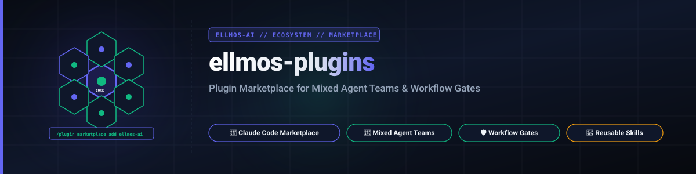
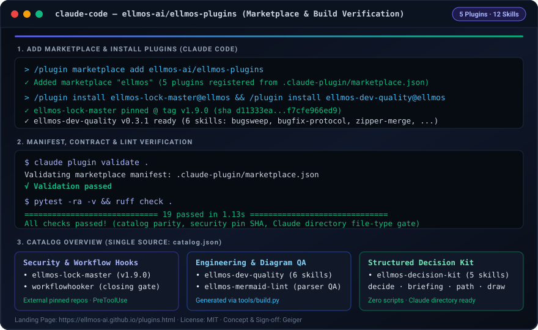
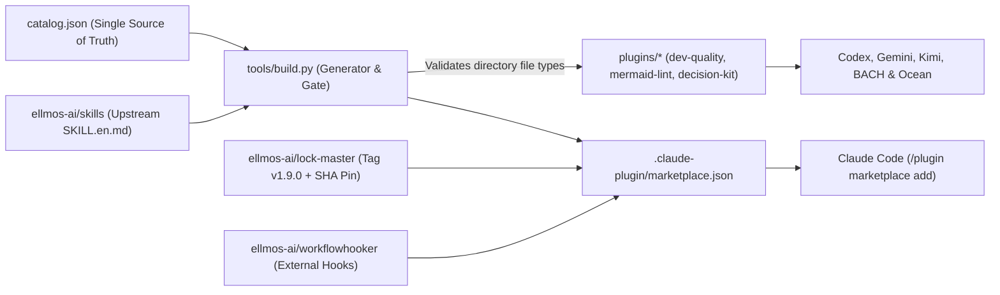
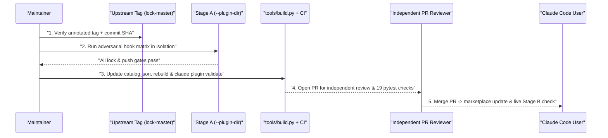

<p align="center">
  
</p>

# ellmos-plugins

**Language:** **English** | [Deutsch](README_de.md)

[](https://github.com/ellmos-ai/ellmos-plugins/actions/workflows/ci.yml)
[](#sec-07)
[](#sec-03)
[](LICENSE)
[](#sec-01)
[](CODE_OF_CONDUCT.md)
[](SKILL.md)
[](llms.txt)
[](https://ellmos-ai.github.io/plugins.html)
[](#sec-07)

The **ellmos** Claude Code plugin marketplace: curated plugins from the ellmos ecosystem for mixed agent teams, file-based locking, workflow closing gates, Mermaid verification, and structured decision workflows.

---

## Quick Navigation

| # | Section | Jump |
|---|---|---|
| 01 | Overview & Marketplace Quickstart | [Overview](#sec-01) |
| 02 | Visual Preview & Architecture Topology | [Architecture](#sec-02) |
| 03 | Marketplace Catalog & Bundled Skills | [Catalog](#sec-03) |
| 04 | Target Audiences & High-Intent Search Queries | [Audiences](#sec-04) |
| 05 | Approach Comparison Matrix | [Comparison](#sec-05) |
| 06 | Install with Your LLM (Policy P-022) | [LLM Install](#sec-06) |
| 07 | How This Repository Is Built & Verified | [Build & QA](#sec-07) |
| 08 | Security Pin Governance & Lifecycle Sequence | [Pin Governance](#sec-08) |
| 09 | Multi-Platform Compatibility Matrix | [Compatibility](#sec-09) |
| 10 | Governance, Documentation & AI Attribution | [Governance](#sec-10) |

---

<a id="sec-01"></a>
## 1. Overview & Marketplace Quickstart

Add the marketplace once in Claude Code and install only the plugins your team needs:

```text
/plugin marketplace add ellmos-ai/ellmos-plugins
/plugin install ellmos-lock-master@ellmos
/plugin install ellmos-dev-quality@ellmos
/plugin install ellmos-decision-kit@ellmos
```

| Plugin | Kind | Version / Pin | What it does | Source |
|---|---|---|---|---|
| `ellmos-lock-master` | External | `v1.9.0` (`d11333ea`) | File-based locks (`LOCK*.txt`) for mixed agent teams; hooks block edits and pushes covered by a foreign lock | [ellmos-ai/lock-master](https://github.com/ellmos-ai/lock-master) |
| `workflowhooker` | External | `main` | Closing workflow gate with one rework round, drift detection, and scope warnings | [ellmos-ai/workflowhooker](https://github.com/ellmos-ai/workflowhooker) |
| `ellmos-dev-quality` | Generated Skills | `0.3.1` | 6 skills: `bugsweep`, `bugfix-protocol`, `zipper-merge`, `repo-publish-check`, `migrate-rename`, `dev-cycle` | `plugins/ellmos-dev-quality` |
| `ellmos-mermaid-lint` | Generated Skills | `0.1.0` | `mermaid-lint`: checks Mermaid blocks with the real parser and confirms GitHub rendering (marketplace only) | `plugins/ellmos-mermaid-lint` |
| `ellmos-decision-kit` | Generated Skills | `0.2.0` | 5 skills: `decide`, `decision-briefing`, `decision-shot`, `decision-path`, `decision-draw` | `plugins/ellmos-decision-kit` |

---

<a id="sec-02"></a>
## 2. Visual Preview & Architecture Topology

<p align="center">
  
</p>

`catalog.json` is the single source of truth. `tools/build.py` reads skill definitions from `ellmos-ai/skills`, strips non-directory files and banners, verifies file-type compliance for the Claude directory, and emits `.claude-plugin/marketplace.json` alongside generated plugin bundles.



---

<a id="sec-03"></a>
## 3. Marketplace Catalog & Bundled Skills

### `ellmos-dev-quality` (`v0.3.1` · 6 Skills)

- `bugsweep` — Systematic repository-wide bug sweep grouped by module and severity.
- `bugfix-protocol` — Root-cause isolation, failing test reproduction, targeted fix, and verification.
- `zipper-merge` — Section-by-section merge resolution without dropping parallel feature work.
- `repo-publish-check` — Pre-publication hygiene, privacy, license, and secret checks.
- `migrate-rename` — Safe cross-file symbol, module, and path renames (excluding helper scripts for directory compliance).
- `dev-cycle` — End-to-end iterative development cycle with explicit verification gates.

### `ellmos-decision-kit` (`v0.2.0` · 5 Skills · Text-Only)

- `decide` — Structured option comparison with weighted criteria and a clear recommendation.
- `decision-briefing` — Consolidated release/project briefing for multiple pending decisions.
- `decision-shot` — Compact single-decision snapshot for fast review.
- `decision-path` — Dependency graph mapping to determine decision ordering.
- `decision-draw` — Ready-to-sign-off draft presentation of options and trade-offs.

### `ellmos-mermaid-lint` (`v0.1.0` · 1 Skill · Marketplace Only)

- `mermaid-lint` — Validates Mermaid blocks with the real `mermaid` parser (`jsdom` / `playwright-core`) and verifies GitHub page rendering. Offered exclusively via this marketplace (not submitted to the Claude directory because it installs npm packages on demand).

---

<a id="sec-04"></a>
## 4. Target Audiences & High-Intent Search Queries

| Persona | Primary Goal | Recommended Plugins |
|---|---|---|
| **Mixed-Agent Team Operator** | Prevent parallel Claude, Codex, and Gemini sessions from overwriting each other's files or pushing prematurely | `ellmos-lock-master`, `workflowhooker` |
| **Release & QA Engineer** | Run structured bug sweeps, zipper merges, Mermaid syntax checks, and pre-publication gates | `ellmos-dev-quality`, `ellmos-mermaid-lint` |
| **Tech Lead / Architect** | Structure architectural trade-offs, GDPR/hosting options, and dependency chains before implementation | `ellmos-decision-kit` |
| **Plugin Marketplace Maintainer** | Rebuild reproducible skill bundles from `catalog.json` with strict file-type and pin-SHA guarantees | `tools/build.py`, `tests/` |

**Common search intents covered:**
- `"claude code plugin marketplace file locking multi agent"`
- `"pin claude code security plugin by tag and commit sha"`
- `"reusable agent skills decide bugsweep zipper merge mermaid lint"`
- `"claude directory compliant skill bundle generator"`

---

<a id="sec-05"></a>
## 5. Approach Comparison Matrix

| Dimension | `ellmos-plugins` Marketplace | Unpinned GitHub Plugin URLs | Manual Copy-Paste of Skills |
|---|---|---|---|
| **Single Catalog Source** | `catalog.json` drives builds and `.claude-plugin/marketplace.json` | Ad-hoc per repository | Manual file sync across machines |
| **Security Hook Pinning** | Mandatory annotated tag `ref` + 40-char commit `sha` (`ellmos-lock-master`) | Floating `main` branch risk | No hook versioning |
| **Claude Directory Compliance** | Automated `check_directory_types()` blocks `#!` scripts and unsupported extensions | Unchecked until rejection | Manual audit required |
| **Upstream Traceability** | Every generated plugin embeds exact upstream commit in `SOURCE.json` | None | Lost after copy |
| **Contract & CI Verification** | Cross-OS CI matrix (`ubuntu`/`windows`/`macos`, Python `3.10–3.13`) + `pytest` | Often absent | None |

---

<a id="sec-06"></a>
## 6. Install with Your LLM (Policy P-022)

Copy this prompt into Claude Code or another coding agent to register the marketplace or set up an isolated `.venv` contributor verification environment (no `curl | sh` pipes):

```text
Inspect https://raw.githubusercontent.com/ellmos-ai/ellmos-plugins/main/llms.txt and https://raw.githubusercontent.com/ellmos-ai/ellmos-plugins/main/SKILL.md first:
1. To use the plugins in Claude Code, guide me through running `/plugin marketplace add ellmos-ai/ellmos-plugins` and installing the plugins I need.
2. To verify the marketplace repository locally, clone it, create an isolated `.venv`, install `.[dev]`, and run `claude plugin validate .`, `pytest -ra -v`, and `ruff check .`.
```

---

<a id="sec-07"></a>
## 7. How This Repository Is Built & Verified

- `catalog.json` is the single source: every plugin, its description, keywords, and compatibility matrix.
- `tools/build.py` generates the skill plugins from [ellmos-ai/skills](https://github.com/ellmos-ai/skills) (English `SKILL.en.md` -> `SKILL.md`, frontmatter reduced to the Agent Skills fields, banners stripped) and writes `.claude-plugin/marketplace.json`. External plugins remain in their own repositories. Never edit `plugins/` by hand; update `ellmos-ai/skills` or `catalog.json` and run `python tools/build.py --skills-repo <path>`.
- Each generated plugin records its exact upstream commit in `SOURCE.json`.
- A plugin submitted to the Claude directory may only hold Markdown, text, JSON, YAML, images, and `LICENSE` (rule for non-verified organizations). `tools/build.py` aborts if anything else is present; entries in `catalog.json` can omit folders via `"exclude": ["scripts"]`.
- Eval suites with scaffold shell scripts live in `evals/<plugin>/` instead of inside the generated plugin folder (`plugins/*/evals/` is gitignored):
  `cp -r evals/ellmos-dev-quality plugins/ellmos-dev-quality/evals && claude plugin eval plugins/ellmos-dev-quality --scaffold; rm -r plugins/ellmos-dev-quality/evals`.
- Local verification (19 contract & metadata tests):

```bash
python -m venv .venv
.venv/bin/python -m pip install -e ".[dev]"   # Windows: .venv\Scripts\python.exe
ruff check .
python -m compileall -q tools tests
pytest -ra -v
claude plugin validate .
```

---

<a id="sec-08"></a>
## 8. Security Pin Governance & Lifecycle Sequence

Security-critical plugins that intercept file edits and git commands (such as `ellmos-lock-master`) **must not** float on mutable branches. In `catalog.json` and `.claude-plugin/marketplace.json`, they are pinned to both an annotated tag reference and the exact commit SHA:

- **Current Pin:** `ellmos-lock-master` is pinned to `ref: "v1.9.0"` (`sha: "d11333eaba683a84491d29018b31ef7cfe966ed9"`).

### 5-Step Pin Bump & Marketplace Update Flow



1. **Verify Annotated Tag:** Inspect the upstream tag object (`git cat-file -t <tag>`); it must be annotated and point to the exact target commit SHA.
2. **Adversarial Probe & Live Acceptance Stage A (`--plugin-dir`):** Validate hooks in an isolated directory using `claude -p --plugin-dir <checkout>` against foreign lock denial, own lock allowance, and subagent ID resolution.
3. **Catalog Update & Manifest Regeneration:** Update `ref` and `sha` in `catalog.json`, run `python tools/build.py`, and run `claude plugin validate .`.
4. **Pull Request & Independent Review:** Open a PR against `ellmos-ai/ellmos-plugins` for review by an independent model instance or operator.
5. **Live Acceptance Stage B:** Only after merge and user sign-off, run `claude plugin marketplace update ellmos` followed by `claude plugin update ellmos-lock-master@ellmos`.

---

<a id="sec-09"></a>
## 9. Multi-Platform Compatibility Matrix

Every generated plugin README embeds its platform table from `catalog.json`:

| Plugin | Claude Code | Claude Directory | Codex | Gemini / Antigravity | Kimi | BACH | Ocean |
|---|---|---|---|---|---|---|---|
| `ellmos-lock-master` | yes | untested | partial | partial | partial | yes | yes |
| `workflowhooker` | yes | untested | partial | no | partial | yes | yes |
| `ellmos-dev-quality` | yes | untested | yes | untested | untested | yes | yes |
| `ellmos-mermaid-lint` | yes | not submitted (npm) | yes | untested | untested | yes | yes |
| `ellmos-decision-kit` | yes | untested | yes | untested | untested | yes | yes |

---

<a id="sec-10"></a>
## 10. Governance, Documentation & License

- **Web Overview:** [ellmos-ai.github.io/plugins.html](https://ellmos-ai.github.io/plugins.html)
- **Governance:** [Contributing](CONTRIBUTING.md) · [Security Policy](SECURITY.md) · [Code of Conduct](CODE_OF_CONDUCT.md) · [Changelog](CHANGELOG.md)
- **LLM Entrypoints:** [SKILL.md](SKILL.md) · [llms.txt](llms.txt) · [llm.txt](llm.txt)
- **License:** MIT — see [LICENSE](LICENSE).

> **Editorial & AI Notice:** Concept & Sign-off: Geiger · Text assistance: LLM-assisted · Graphics: SVG-generated
