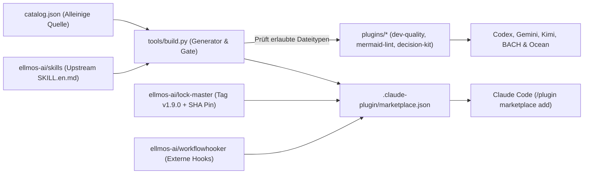
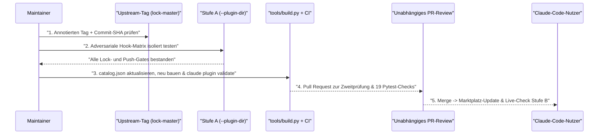

<p align="center">
  
</p>

# ellmos-plugins

**Sprache:** [English](README.md) | **Deutsch**

[](https://github.com/ellmos-ai/ellmos-plugins/actions/workflows/ci.yml)
[](#sec-07)
[](#sec-03)
[](LICENSE)
[](#sec-01)
[](CODE_OF_CONDUCT.md)
[](SKILL.md)
[](llms.txt)
[](https://ellmos-ai.github.io/plugins.html)
[](#sec-07)

Der **ellmos** Claude-Code-Plugin-Marktplatz: kuratierte Plugins aus dem ellmos-Ökosystem für gemischte Agenten-Teams, dateibasierte Sperren, Workflow-Abschluss-Gates, Mermaid-Verifikation und strukturierte Entscheidungs-Workflows.

---

## Schnellnavigation

| # | Abschnitt | Sprungmarke |
|---|---|---|
| 01 | Überblick & Marktplatz-Schnellstart | [Überblick](#sec-01) |
| 02 | Visuelle Vorschau & Architektur-Topologie | [Architektur](#sec-02) |
| 03 | Marktplatz-Katalog & gebündelte Skills | [Katalog](#sec-03) |
| 04 | Zielgruppen & Suchanfragen | [Zielgruppen](#sec-04) |
| 05 | Vergleichsmatrix | [Vergleich](#sec-05) |
| 06 | Mit deinem LLM installieren (Policy P-022) | [LLM-Installation](#sec-06) |
| 07 | Aufbau & lokale Verifikation | [Aufbau & QA](#sec-07) |
| 08 | Pin-Governance & Ablaufsequenz | [Pin-Governance](#sec-08) |
| 09 | Plattform-Kompatibilitätsmatrix | [Kompatibilität](#sec-09) |
| 10 | Governance, Dokumentation & KI-Hinweis | [Governance](#sec-10) |

---

<a id="sec-01"></a>
## 1. Überblick & Marktplatz-Schnellstart

Füge den Marktplatz einmalig in Claude Code hinzu und installiere gezielt die benötigten Plugins:

```text
/plugin marketplace add ellmos-ai/ellmos-plugins
/plugin install ellmos-lock-master@ellmos
/plugin install ellmos-dev-quality@ellmos
/plugin install ellmos-decision-kit@ellmos
```

| Plugin | Typ | Version / Pin | Aufgabe | Quelle |
|---|---|---|---|---|
| `ellmos-lock-master` | Extern | `v1.9.0` (`d11333ea`) | Dateibasierte Sperren (`LOCK*.txt`) für gemischte Agenten-Teams; Hooks blockieren Edits und Pushes bei fremdem Lock | [ellmos-ai/lock-master](https://github.com/ellmos-ai/lock-master) |
| `workflowhooker` | Extern | `main` | Abschluss-Gate mit einer Nachbesserungsrunde, Drift-Erkennung und Scope-Warnungen | [ellmos-ai/workflowhooker](https://github.com/ellmos-ai/workflowhooker) |
| `ellmos-dev-quality` | Generierte Skills | `0.3.1` | 6 Skills: `bugsweep`, `bugfix-protocol`, `zipper-merge`, `repo-publish-check`, `migrate-rename`, `dev-cycle` | `plugins/ellmos-dev-quality` |
| `ellmos-mermaid-lint` | Generierte Skills | `0.1.0` | `mermaid-lint`: prüft Mermaid-Blöcke mit dem echten Parser und bestätigt GitHub-Rendering (nur Marktplatz) | `plugins/ellmos-mermaid-lint` |
| `ellmos-decision-kit` | Generierte Skills | `0.2.0` | 5 Skills: `decide`, `decision-briefing`, `decision-shot`, `decision-path`, `decision-draw` | `plugins/ellmos-decision-kit` |

---

<a id="sec-02"></a>
## 2. Visuelle Vorschau & Architektur-Topologie

<p align="center">
  
</p>

`catalog.json` ist die alleinige Quelle der Wahrheit. `tools/build.py` liest die Skill-Definitionen aus `ellmos-ai/skills`, entfernt Nicht-Directory-Dateien und Banner, prüft die Dateityp-Konformität für das Claude Directory und erzeugt `.claude-plugin/marketplace.json` samt den generierten Plugin-Paketen.



---

<a id="sec-03"></a>
## 3. Marktplatz-Katalog & gebündelte Skills

### `ellmos-dev-quality` (`v0.3.1` · 6 Skills)

- `bugsweep` — Systematische Repo-weite Bug-Suche, gruppiert nach Modul und Schweregrad.
- `bugfix-protocol` — Ursachenanalyse, fehlgeschlagener Reproduktionstest, gezielter Fix und Verifikation.
- `zipper-merge` — Abschnittsweises Zusammenführen paralleler Änderungen ohne Verlust fremder Arbeit.
- `repo-publish-check` — Vorveröffentlichungs-Gate für Hygiene, Privacy, Lizenzen und Secrets.
- `migrate-rename` — Sicheres dateiübergreifendes Umbenennen von Symbolen, Modulen und Pfaden (ohne Hilfsskripte für Directory-Konformität).
- `dev-cycle` — Durchgängiger Entwicklungszyklus mit klaren Abnahme-Gates.

### `ellmos-decision-kit` (`v0.2.0` · 5 Skills · reines Textformat)

- `decide` — Strukturierter Variantenvergleich mit gewichteten Kriterien und klarer Empfehlung.
- `decision-briefing` — Gebündeltes Briefing für mehrere offene Release- oder Projektentscheidungen.
- `decision-shot` — Kompakte Einzelentscheidungs-Übersicht für schnelle Freigaben.
- `decision-path` — Abhängigkeitsanalyse zur optimalen Entscheidungsreihenfolge.
- `decision-draw` — Entscheidungsreife Ausarbeitung von Optionen und Zielkonflikten.

### `ellmos-mermaid-lint` (`v0.1.0` · 1 Skill · nur Marktplatz)

- `mermaid-lint` — Validiert Mermaid-Blöcke mit dem echten `mermaid`-Parser (`jsdom` / `playwright-core`) und bestätigt das Rendering auf GitHub. Ausschließlich über diesen Marktplatz verfügbar (nicht im Claude Directory eingereicht, da bei Ausführung npm-Pakete installiert werden).

---

<a id="sec-04"></a>
## 4. Zielgruppen & Suchanfragen

| Zielgruppe | Hauptziel | Empfohlene Plugins |
|---|---|---|
| **Operator gemischter Agenten-Teams** | Parallele Claude-, Codex- und Gemini-Sessions vor Überschreibungen und voreiligen Pushes schützen | `ellmos-lock-master`, `workflowhooker` |
| **Release- & QA-Ingenieur** | Systematische Bug-Sweeps, Reißverschluss-Merges, Mermaid-Prüfungen und Veröffentlichungs-Checks ausführen | `ellmos-dev-quality`, `ellmos-mermaid-lint` |
| **Tech Lead / Architekt** | Architektur-Abwägungen, DSGVO-/Hosting-Optionen und Abhängigkeitsketten vorab strukturieren | `ellmos-decision-kit` |
| **Marktplatz-Maintainer** | Reproduzierbare Skill-Pakete aus `catalog.json` mit strikten Dateityp- und Pin-SHA-Garantien erzeugen | `tools/build.py`, `tests/` |

**Abgedeckte Suchanfragen:**
- `"claude code plugin marktplatz lock dateisystem multi agent"`
- `"sicherheits plugin tag und commit sha pinning claude code"`
- `"wiederverwendbare agent skills decide bugsweep zipper merge mermaid lint"`
- `"claude directory konforme skill bundles generator"`

---

<a id="sec-05"></a>
## 5. Vergleichsmatrix

| Dimension | `ellmos-plugins` Marktplatz | Ungepinnte GitHub-Plugin-URLs | Manuelles Kopieren von Skills |
|---|---|---|---|
| **Zentrale Katalogquelle** | `catalog.json` steuert Build und `.claude-plugin/marketplace.json` | Ad-hoc pro Repository | Manueller Dateiabgleich |
| **Sicherheits-Hook-Pinning** | Pflicht: annotierter Tag `ref` + 40-stelliges Commit-`sha` (`ellmos-lock-master`) | Risiko durch schwebendes `main` | Keine Hook-Versionierung |
| **Claude-Directory-Konformität** | Automatisches `check_directory_types()` blockiert `#!`-Skripte und unzulässige Dateien | Ungeprüft bis zur Ablehnung | Manuelle Prüfung nötig |
| **Upstream-Nachvollziehbarkeit** | Jedes generierte Plugin speichert den exakten Quell-Commit in `SOURCE.json` | Keine | Geht beim Kopieren verloren |
| **Vertragstests & CI** | Multi-OS-CI-Matrix (`ubuntu`/`windows`/`macos`, Python `3.10–3.13`) + `pytest` | Oft nicht vorhanden | Keine |

---

<a id="sec-06"></a>
## 6. Mit deinem LLM installieren

Kopiere diesen Prompt in Claude Code oder einen anderen Coding-Agenten, um den Marktplatz hinzuzufügen oder eine isolierte `.venv`-Umgebung zur lokalen Prüfung einzurichten (ohne `curl | sh`-Pipes):

```text
Lies zuerst https://raw.githubusercontent.com/ellmos-ai/ellmos-plugins/main/llms.txt und https://raw.githubusercontent.com/ellmos-ai/ellmos-plugins/main/SKILL.md:
1. Für die Nutzung in Claude Code führe mich durch `/plugin marketplace add ellmos-ai/ellmos-plugins` und die Installation der passenden Plugins.
2. Für die lokale Verifikation des Repositorys klone das Repo, erstelle eine isolierte `.venv`, installiere `.[dev]` und führe `claude plugin validate .`, `pytest -ra -v` und `ruff check .` aus.
```

---

<a id="sec-07"></a>
## 7. Aufbau & lokale Verifikation

- `catalog.json` ist die alleinige Quelle: jedes Plugin, seine Beschreibung, Schlüsselwörter und Kompatibilität.
- `tools/build.py` generiert die Skill-Plugins aus [ellmos-ai/skills](https://github.com/ellmos-ai/skills) (englisches `SKILL.en.md` -> `SKILL.md`, Frontmatter auf Agent-Skills-Felder reduziert, Banner entfernt) und schreibt `.claude-plugin/marketplace.json`. Plugins mit eigenem Code bleiben in ihrem eigenen Repository. Bearbeite `plugins/` niemals von Hand; ändere `ellmos-ai/skills` oder `catalog.json` und führe `python tools/build.py --skills-repo <Pfad>` aus.
- Jedes generierte Plugin speichert seinen exakten Quell-Commit in `SOURCE.json`.
- Ein für das Claude Directory eingereichtes Plugin darf nur Markdown, Text, JSON, YAML, Bilder und seine `LICENSE` enthalten (Regel für nicht verifizierte Organisationen). `tools/build.py` bricht bei unerlaubten Dateien ab; Einträge in `catalog.json` können Ordner per `"exclude": ["scripts"]` auslassen.
- Eval-Suites mit Scaffold-Shell-Skripten liegen unter `evals/<plugin>/` statt im generierten Plugin-Ordner (`plugins/*/evals/` wird von Git ignoriert):
  `cp -r evals/ellmos-dev-quality plugins/ellmos-dev-quality/evals && claude plugin eval plugins/ellmos-dev-quality --scaffold; rm -r plugins/ellmos-dev-quality/evals`.
- Lokale Verifikation (19 Vertrags- und Metadatentests):

```bash
python -m venv .venv
.venv/bin/python -m pip install -e ".[dev]"   # Windows: .venv\Scripts\python.exe
ruff check .
python -m compileall -q tools tests
pytest -ra -v
claude plugin validate .
```

---

<a id="sec-08"></a>
## 8. Pin-Governance & Ablaufsequenz

Sicherheitskritische Plugins, die Dateizugriffe und Git-Befehle abfangen (wie `ellmos-lock-master`), **dürfen nicht** auf veränderlichen Branches schweben. In `catalog.json` und `.claude-plugin/marketplace.json` sind sie sowohl auf eine annotierte Tag-Referenz als auch auf den exakten Commit-SHA gepinnt:

- **Aktueller Pin:** `ellmos-lock-master` ist auf `ref: "v1.9.0"` (`sha: "d11333eaba683a84491d29018b31ef7cfe966ed9"`) gepinnt.

### 5-stufiges Pin-Update- & Marktplatz-Verfahren



1. **Annotierten Tag verifizieren:** Upstream-Tag-Objekt prüfen (`git cat-file -t <tag>`); der Tag muss annotiert sein und exakt auf den Ziel-Commit-SHA zeigen.
2. **Adversarial Probe & Live-Abnahme Stufe A (`--plugin-dir`):** Hooks in einem isolierten Verzeichnis mit `claude -p --plugin-dir <checkout>` gegen fremde Lock-Blockaden, eigene Lock-Freigaben und Subagent-ID-Auflösung prüfen.
3. **Katalog-Update & Manifest-Regenerierung:** `ref` und `sha` in `catalog.json` aktualisieren, `python tools/build.py` und `claude plugin validate .` ausführen.
4. **Pull Request & unabhängiges Review:** Pull Request auf `ellmos-ai/ellmos-plugins` für eine unabhängige Modellinstanz oder einen Operator einreichen.
5. **Live-Abnahme Stufe B:** Erst nach Merge und Nutzerfreigabe `claude plugin marketplace update ellmos` und anschließend `claude plugin update ellmos-lock-master@ellmos` ausführen.

---

<a id="sec-09"></a>
## 9. Plattform-Kompatibilitätsmatrix

Jedes generierte Plugin-README enthält seine aus `catalog.json` abgeleitete Plattform-Tabelle:

| Plugin | Claude Code | Claude Directory | Codex | Gemini / Antigravity | Kimi | BACH | Ocean |
|---|---|---|---|---|---|---|---|
| `ellmos-lock-master` | ja | ungetestet | teilweise | teilweise | teilweise | ja | ja |
| `workflowhooker` | ja | ungetestet | teilweise | nein | teilweise | ja | ja |
| `ellmos-dev-quality` | ja | ungetestet | ja | ungetestet | ungetestet | ja | ja |
| `ellmos-mermaid-lint` | ja | nicht eingereicht (npm) | ja | ungetestet | ungetestet | ja | ja |
| `ellmos-decision-kit` | ja | ungetestet | ja | ungetestet | ungetestet | ja | ja |

---

<a id="sec-10"></a>
## 10. Governance, Dokumentation & Lizenz

- **Web-Übersicht:** [ellmos-ai.github.io/plugins.html](https://ellmos-ai.github.io/plugins.html)
- **Governance:** [Beitragsrichtlinie](CONTRIBUTING.md) · [Sicherheitsrichtlinie](SECURITY.md) · [Verhaltenskodex](CODE_OF_CONDUCT.md) · [Changelog](CHANGELOG.md)
- **LLM-Einstiegspunkte:** [SKILL.md](SKILL.md) · [llms.txt](llms.txt) · [llm.txt](llm.txt)
- **Lizenz:** MIT — siehe [LICENSE](LICENSE).

> **Redaktion & KI-Hinweis:** Idee & Abnahme: Geiger · Textassistenz: LLM-gestützt · Grafik: SVG-generiert
