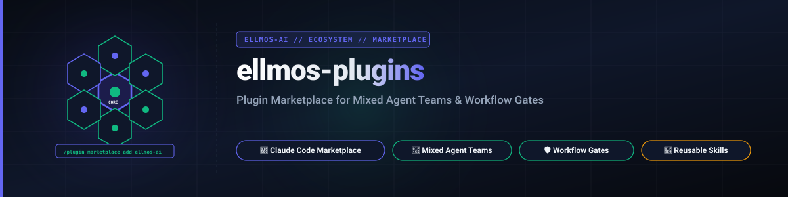

<p align="center">
  
</p>

# ellmos-plugins

**Sprache:** [English](README.md) | **Deutsch**

[](https://github.com/ellmos-ai/ellmos-plugins/actions/workflows/ci.yml)
[](#aufbau-des-repositorys)
[](LICENSE)
[](#ellmos-plugins)
[](llms.txt)
[](#aufbau-des-repositorys)

Der **ellmos** Claude-Code-Plugin-Marktplatz: Plugins aus dem ellmos-Ökosystem für gemischte Agenten-Teams,
Workflow-Gates und wiederverwendbare Skills.

```
/plugin marketplace add ellmos-ai/ellmos-plugins
/plugin install <plugin>@ellmos
```

| Plugin | Aufgabe | Speicherort |
|---|---|---|
| `ellmos-lock-master` | Dateibasierte Sperren für gemischte Agenten-Teams; Hooks blockieren Edits und Pushes bei fremdem Lock | [ellmos-ai/lock-master](https://github.com/ellmos-ai/lock-master) |
| `workflowhooker` | Abschluss-Gate mit einer Nachbesserungsrunde, Drift- und Scope-Warnungen | [ellmos-ai/workflowhooker](https://github.com/ellmos-ai/workflowhooker) |
| `ellmos-dev-quality` | Bug-Sweeps, Bugfix-Protokoll, Reißverschluss-Merges, Vorveröffentlichungs-Checks, Umbenennungen, Dev-Cycle | `plugins/ellmos-dev-quality` (generiert) |
| `ellmos-mermaid-lint` | Prüft Mermaid-Blöcke mit dem echten Parser und bestätigt das GitHub-Rendering (installiert npm-Pakete, daher nur Marktplatz) | `plugins/ellmos-mermaid-lint` (generiert) |
| `ellmos-decision-kit` | Entscheiden, Entscheidungs-Briefings, Decision Shots, Abhängigkeitspfade, Entwurfs-Skizzen | `plugins/ellmos-decision-kit` (generiert) |

### Mit deinem LLM installieren

Kopiere diesen Prompt in Claude Code oder einen anderen Coding-Agenten, um den Marktplatz hinzuzufügen und zu prüfen:

```text
Lies https://raw.githubusercontent.com/ellmos-ai/ellmos-plugins/main/llms.txt und https://raw.githubusercontent.com/ellmos-ai/ellmos-plugins/main/SKILL.md und führe mich durch das Hinzufügen des Claude-Code-Marktplatzes ellmos-ai/ellmos-plugins sowie die Installation der gewünschten Plugins.
```

## Aufbau des Repositorys

- `catalog.json` ist die alleinige Quelle: jedes Plugin, seine Beschreibung, Schlüsselwörter und Kompatibilität.
- `tools/build.py` generiert die Skill-Plugins aus [ellmos-ai/skills](https://github.com/ellmos-ai/skills)
  (englisches `SKILL.en.md` → `SKILL.md`, Frontmatter auf Agent-Skills-Felder reduziert, Banner entfernt) und schreibt
  `.claude-plugin/marketplace.json`. Plugins mit eigenem Code bleiben in ihrem eigenen Repository und werden hier nur
  gelistet. Bearbeite `plugins/` niemals von Hand; ändere das Skills-Repository oder `catalog.json` und führe
  `python tools/build.py --skills-repo <Pfad>` aus.
- Jedes generierte Plugin speichert seinen Quell-Commit in `SOURCE.json`.
- Ein für das Claude Directory eingereichtes Plugin darf nur Markdown, Text, JSON, YAML, Bilder und seine `LICENSE`
  enthalten (Regel für nicht verifizierte Organisationen). `tools/build.py` stoppt bei unerlaubten Dateien; ein Eintrag
  in `catalog.json` kann Ordner mit `"exclude": ["scripts"]` ausschließen.
- Eval-Suites liegen unter `evals/<plugin>/` und nicht im Plugin, da ihre Scaffold-Skripte Shell-Dateien sind. Zur
  Ausführung kopieren, ausführen und anschließend wieder entfernen (`plugins/*/evals/` wird von Git ignoriert):
  `cp -r evals/ellmos-dev-quality plugins/ellmos-dev-quality/evals && claude plugin eval plugins/ellmos-dev-quality --scaffold; rm -r plugins/ellmos-dev-quality/evals`.
- Lokale Verifikation: `ruff check .`, `pytest -ra -v` und `claude plugin validate .`.

## Pin-Governance (Sicherheits-Plugins)

Sicherheitskritische Plugins, die Dateizugriffe und Git-Befehle abfangen (wie `ellmos-lock-master`), DÜRFEN NICHT auf
veränderlichen Branches schweben. In `catalog.json` und `.claude-plugin/marketplace.json` sind diese Plugins sowohl auf
eine explizite Tag-Referenz als auch auf den exakten Commit-SHA gepinnt:

- **Aktueller Pin:** `ellmos-lock-master` ist auf `ref: "v1.9.0"` (`sha: "d11333eaba683a84491d29018b31ef7cfe966ed9"`) gepinnt.

### Verbindlicher Prozess für Pin-Updates

Ein Pin-Update für ein Sicherheits-Plugin erfordert ein striktes 5-stufiges Gate vor der Übernahme:

1. **Annotierten Tag verifizieren:** Upstream-Tag-Objekt prüfen (z. B. `git cat-file -t <tag>`). Der Tag muss annotiert sein und exakt auf den Ziel-Commit-SHA zeigen.
2. **Adversarial Probe & Live-Abnahme Stufe A (`--plugin-dir`):** Tag in einem isolierten Verzeichnis auschecken und die Hooks über frische `claude -p`-Läufe mit `--plugin-dir <checkout>` gegen die vollständige adversariale Testmatrix prüfen. Während Stufe A niemals Marktplatz-Updates ausführen.
3. **Katalog-Update & Manifest-Regenerierung:** `ref` und `sha` in `catalog.json` aktualisieren, `python tools/build.py` ausführen und mit `claude plugin validate .` prüfen, ob `.claude-plugin/marketplace.json` gültig ist.
4. **Pull Request & unabhängiges Review:** Pull Request auf `ellmos-ai/ellmos-plugins` erstellen. Das Review muss durch eine unabhängige Modellinstanz oder einen Operator erfolgen.
5. **Live-Abnahme Stufe B (Live-Marktplatzpfad):** Erst nach Merge und Nutzerfreigabe den echten Update-Pfad ausführen (`claude plugin marketplace update ellmos`, danach `claude plugin update ellmos-lock-master@ellmos`) und Laufzeitstatus sowie Cache-Pfad in einer sauberen Session prüfen.

## Kompatibilität

Jedes Plugin-README enthält eine aus `catalog.json` generierte Kompatibilitätstabelle (Claude Code, Claude Directory,
Codex, Gemini/Antigravity, Kimi, BACH, Ocean).

## Governance & Dokumentation

- [Beitragsrichtlinie](CONTRIBUTING.md) · [Sicherheitsrichtlinie](SECURITY.md) · [Verhaltenskodex](CODE_OF_CONDUCT.md) · [Changelog](CHANGELOG.md)
- LLM-Einstiegspunkte: [SKILL.md](SKILL.md) · [llms.txt](llms.txt) · [llm.txt](llm.txt)

## Lizenz

MIT — siehe [LICENSE](LICENSE).
